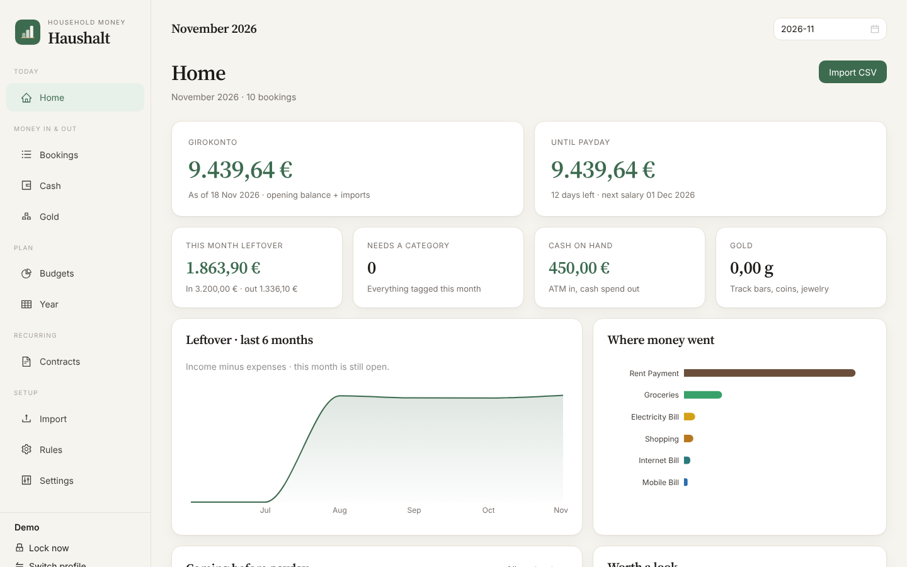

<p align="center">
  
</p>

<h1 align="center">Haushalt</h1>

<p align="center">
  <em>Your bank statement, finally making sense. Your data, never leaving home.</em>
</p>

<p align="center">
  <a href="LICENSE"></a>
  
  
  
  <a href="https://github.com/mohdahmedasif/haushalt/issues?q=is%3Aissue+is%3Aopen+label%3A%22good+first+issue%22"></a>
</p>

Drop in a CSV from Sparkasse, Volksbank, DKB or ING and Haushalt sorts every booking, tracks your budgets and tells you where the money went. No cloud account, no bank login: everything lives in SQLite on your own machine.

## What it does

- 📥 **Import** CSVs from Sparkasse, Volksbank, DKB and ING, with duplicates caught automatically
- 🏷️ **Auto-categorize** with rules that learn from your corrections
- 📊 **Budgets and a year sheet** that show the month at a glance
- 💶 **Cash wallet, lending and gold**, alongside your bank account
- 🔁 **Contracts** spotted from recurring payments, optionally labeled by Gemini
- 👨‍👩‍👧 **Profiles with PINs**, each with its own separate books

<p align="center">
  
</p>

## Quick start

Requires Node.js 22 or later.

```bash
git clone https://github.com/mohdahmedasif/haushalt.git
cd haushalt
npm install
npm run dev
```

Open http://127.0.0.1:5173. The setup wizard walks you through the rest.

Or with Docker:

```bash
docker compose up -d --build
```

## Configuration

Optional, in `.env` (copy `.env.example`):

| Variable | Default | Purpose |
| --- | --- | --- |
| `ADMIN_KEY` | generated | Pairs a new browser and resets a forgotten PIN |
| `PORT` | `8787` | Port the app is served on |
| `TRUST_PROXY` | not set | Number of reverse proxies in front of the app |

A browser is paired once with the admin key, then each person unlocks their profile with a PIN. Use HTTPS whenever the app is reachable beyond `localhost`. The Gemini key is set under **Settings** and stored encrypted.

**Backup:** **Import → Backup** saves a profile as one JSON file, and **Restore** brings it back on any install.

## Privacy

Your books stay in `data/`, which git ignores. Never commit or share a bank CSV, a database file, a backup or `.env`, and never paste IBANs or bookings into an issue.

## Contributing

Contributions are welcome. Start with [CONTRIBUTING.md](CONTRIBUTING.md), and please follow the [Code of Conduct](CODE_OF_CONDUCT.md). Report vulnerabilities privately as described in [SECURITY.md](SECURITY.md). The API is documented in [API.md](API.md).

## License

Released under the [MIT License](LICENSE).
